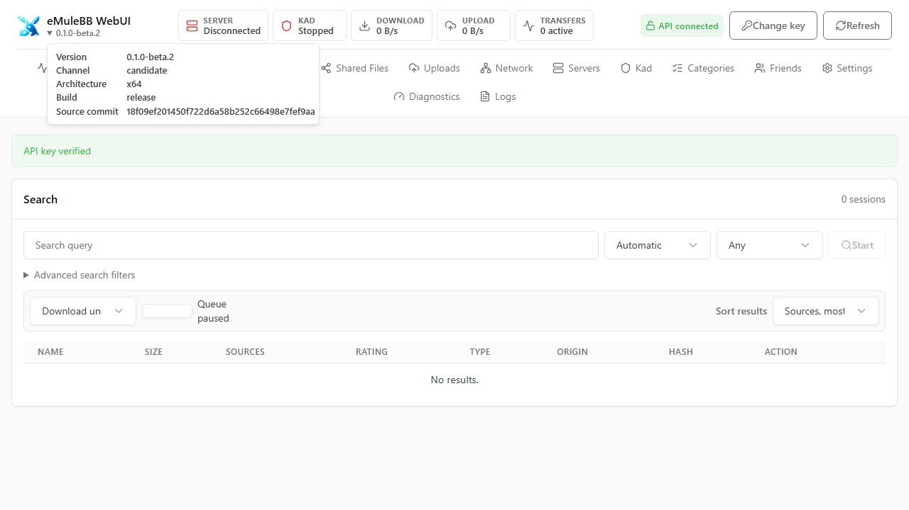

# Getting Started

eMuleBB Rust is a headless IPv4 eD2K/Kad client with a browser console and REST
API. Start with a [matching nightly package](GUIDE-DOWNLOADS-PLATFORMS.md), verify
its checksum, and keep the complete extracted layout, including `webui`. No Rust
toolchain is needed to use the native packages.

{ width="1280" height="720" }

Controlled Windows x64 candidate-package capture from
[source commit `18f09ef`](https://github.com/emulebb/emulebb-rust/commit/18f09ef201450f722d6a58b252c66498e7fef9aa).

## First Launch

On Windows, run `emulebb-rust.exe`; for an extracted Linux native archive, run
`./emulebb-rust` from its directory. DEB users can run `emulebb-rust`. On macOS,
launch the copied app. Container and Android users must follow their separate
[package notes](GUIDE-DOWNLOADS-PLATFORMS.md).

The ready-package bootstrap contract is being implemented under
[#297](https://github.com/emulebb/emulebb-rust/issues/297); use the README shipped
with your selected package for its exact qualified behavior.

Without `--profile`, the daemon uses the **directory containing its executable**
on every platform, independently of the shell working directory. A missing
bootstrap is created from the canonical packaged template. There is no home,
XDG or Local AppData fallback; an unwritable executable directory fails visibly.
Open `http://127.0.0.1:20017/` and enter
`change_me_123change_me_123change_me_123`. This is a shared starter key: replace
it before exposing the API outside this computer. Existing profiles are never
overwritten by startup. Use `--profile <writable-directory>` to override the
profile; missing directories/configuration are created. Relative arguments
resolve from the shell working directory. `--profile .` equals the default only
when the shell working directory is the executable directory.

| Launch mode | Profile selection |
| --- | --- |
| Direct daemon, every platform | Directory containing the executable |
| Explicit `--profile <directory>` | Selected directory; relative to shell working directory |
| Linux desktop launcher | Explicit `$XDG_CONFIG_HOME/emulebb-rust` or `~/.config/emulebb-rust` |
| macOS app launcher | Explicit `~/Library/Application Support/emulebb-rust` |
| Official container | Explicit `/config/emulebb-rust` |

Installed CLI binaries may live in read-only directories; pass a writable
`--profile` instead of running them with elevated permissions. A profile
override does not repair an incompatible database.
The one-shot [stock/MFC importer](GUIDE-PROFILE-IMPORT.md) retains its explicit
manifest-validation workflow.

For portable updates, preserve your selected TOML/database and replace program
files deliberately. Raw archive extraction follows the extractor's overwrite
choice; it is not configuration merging or profile management.

**Loopback REST does not mean offline P2P.** Startup may fetch trusted discovery
inputs and start configured networking. Use a deliberately isolated configuration
and the supported harness when testing offline; a first launch is not that harness.

## Profile And Control-Plane Settings

The minimal bootstrap TOML owns REST binding/authentication and optional asset
location. The canonical ready configuration is:

```toml
[rest]
bind_addr = "127.0.0.1:20017"
api_key = "change_me_123change_me_123change_me_123"
```

Replace the shared starter key with a private value before external exposure.
Startup rejects
blank, documented placeholder, whitespace-padded, non-printable and shorter-than-32
character keys. The ready starter key has 36 ASCII characters. Unix profile and
bootstrap permissions are private (`0700`/`0600`); permissive existing bootstrap
files are rejected with a remediation message. Never commit this file.

Mutable client/network settings live in SQLite and are exposed by Settings and
the [API](../api/GUIDE-API-CONSUMERS.md). Do not add a second set of runtime keys
to bootstrap TOML. Keep the REST listener on loopback for local use. The daemon
serves plain HTTP; a remote deployment needs a trusted TLS reverse proxy and
independent access restrictions. `webui` normally sits beside the executable;
optional `[rest].web_root_dir` resolves relative to the profile when not absolute.

## Connect And Check Reachability

Review **Network**, **Servers** and **Kad** in the console. Check your intended
P2P interface and incoming/category directories before starting transfers.
First-run listener defaults are eD2K TCP 20019, Kad UDP 20020 and REST TCP 20017.
Router/firewall/container mappings must match your chosen settings; High ID is
not guaranteed behind every NAT, router or VPN.

If route detection is ambiguous, select the intended interface explicitly for
that run with `--p2p-bind-interface "INTERFACE_NAME"`, then save the network
setting through the console. Do not bypass an unresolved bind by exposing REST
or selecting an arbitrary interface. VPN use is optional and does not itself
establish native leak-safety proof.

Empty enabled discovery lists may trigger trusted bootstrap downloads. Bootstrap
failure leaves the console available for manual recovery. The policy target is
read-only `server.met`/`nodes.dat` import, but removal of remaining `nodes.dat`
write-back is still tracked by [RUST-FEAT-062](../active/items/RUST-FEAT-062.md).
Do not treat bootstrap file formats as a second mutable-settings authority.

## Search, Download And Share

After connecting, search for a synthetic name such as **Sample File**, inspect
the result and choose its download action. Watch **Transfers** for sources,
progress and errors. An empty search alone does not mean installation failed;
availability, server/Kad state, peers, queues and reachability affect results.
Only download content you are entitled to access.

Add an intentionally chosen folder under **Shared Directories**, review ignore
rules, and watch scan/hash progress in **Shared Files**. Each shared root is a
recursive, monitored tree. There are no single-file sharing-management controls
or non-recursive mode. Use a dedicated sample directory rather than your home
directory; review the files it contains before sharing.

## Shutdown, Updates And Rollback

Stop gracefully using the console/API shutdown operation or the process/service's
normal stop. Preserve the stopped profile, payloads and old binary before an
update. Inspect the selected nightly's schema warning and source revision.

Minimal TOML bootstrap settings have a stability goal separate from the beta's
explicitly unstable API/database. An incompatible schema is visibly rejected
and requires an **entirely fresh profile**. The client does not migrate, reset,
delete, move or partially repair the old profile. Keep it and its payloads intact
for explicit rollback with the matching old binary. Do not edit schema markers,
delete the database, use internal harness migrations or promise automatic
continuation of unfinished transfers in a new incompatible profile.

The stock/MFC importer is a separate read-only source import into the current
Rust schema. It does not provide cross-version Rust database migration or carry
unfinished downloads. See [the import guide](GUIDE-PROFILE-IMPORT.md).

## Logging And Listener Troubleshooting

Regular builds log INFO and above to the console, bounded REST buffer and daily
JSON Lines under `<profile>/logs`. The logger retains the newest eight files;
file-output failure warns and leaves console/API logging available. `RUST_LOG`
controls the tracing filter, for example `warn` or `info,emulebb_core=debug`.
The API buffer retains 2,000 entries and truncates rendered messages at 4 KiB;
clearing that buffer does not delete retained files.

On Windows, REST socket error 10013 means access denied. It can involve reserved
ports, exclusive socket ownership or security software. Inspect the REST address
in the error separately from your P2P interface. For the default port:

```powershell
netsh interface ipv4 show excludedportrange protocol=tcp
Get-NetTCPConnection -LocalPort 20017 -ErrorAction SilentlyContinue
```

Choose an available loopback port if needed. A temporary
`--rest-bind-addr 127.0.0.1:14711` changes only that run; browse to the matching
address. To retain it, stop the daemon and update `[rest].bind_addr` in the private
bootstrap TOML. This does not change eD2K/Kad ports. For ambiguous P2P routing,
`Get-NetAdapter | Select-Object Name, Status` identifies Windows interface names;
use the intended name with `--p2p-bind-interface`, then persist through Settings.

The browser console is served at the REST origin root, with history routes such
as `/transfers` and static `/assets`. Reverse-proxy subpath mounting is not part
of the current deployment contract. Keep the complete packaged asset directory.

## Common Problems

| Symptom | First check |
| --- | --- |
| Executable will not start | CPU/package match and the selected build's host dependencies |
| Console assets missing | Complete package layout, adjacent `webui`, configured asset root |
| API returns 401 | Exact private `X-API-Key`; do not substitute Basic/Bearer authentication |
| REST bind fails | Occupied/reserved port and configured loopback listener, separately from P2P |
| Default route ambiguous | Explicit intended P2P interface, then persist through Settings |
| Schema rejected | Preserve the old profile; select an entirely fresh profile for the new binary |

Regular logs are available in the console, bounded API log buffer and retained
profile log files. Diagnostic bundles are **private operator evidence** and can
contain the exact API key, paths, identifiers and logs. Do not attach them
unreviewed to a public issue. Report suspected vulnerabilities through the
[private security route](https://github.com/emulebb/emulebb-rust/security/advisories/new).

Next: [API consumers](../api/GUIDE-API-CONSUMERS.md),
[contributors](GUIDE-CONTRIBUTING.md), or [release scope](../RELEASE-SCOPE.md).
